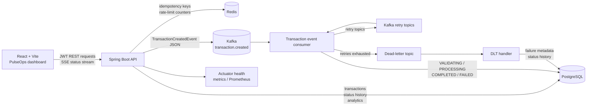

# PulseOps

PulseOps is an event-driven transaction processing platform with a React operations console for creating, processing, and investigating financial transactions. It combines a Spring Boot API, PostgreSQL as the durable system of record, Kafka for asynchronous processing, and Redis for idempotency and rate-limit controls.

The project is designed around an operator’s questions: What happened to this transaction? Which processing stage is it in? Did it fail, retry, or reach the dead-letter topic? What is the current system activity over a selected time range?

## Overview

A transaction starts as an authenticated REST request. The API validates the amount and currency, applies the creation rate limit, checks the idempotency key in Redis, writes the transaction to PostgreSQL with status `RECEIVED`, and publishes a JSON `TransactionCreatedEvent` to Kafka.

The consumer processes that event independently from the HTTP request. It records the lifecycle in PostgreSQL status history as the transaction moves through `VALIDATING`, `PROCESSING`, and either `COMPLETED` or `FAILED`. The frontend reads this persisted data through the API and can subscribe to status changes with Server-Sent Events. A page refresh therefore reconstructs the same state from PostgreSQL rather than relying on browser memory.

## Architecture



In the development Compose stack, the browser uses the frontend at port `3001`. Nginx proxies `/api` and SSE requests to the application at port `8080`. The application connects to PostgreSQL, Kafka, and Redis by their Compose service names. The production Compose configuration adds Caddy for HTTPS and keeps the backend services private.

## Transaction flow

1. The client signs in through `POST /api/v1/auth/login`. The backend compares the request with credentials supplied through environment variables and returns an eight-hour JWT.
2. The client sends `POST /api/v1/transactions` with a bearer token, an `Idempotency-Key`, and an optional `X-Correlation-ID`.
3. Bean validation rejects non-positive amounts or currencies that are not exactly three letters. Redis prevents the same idempotency key from creating a duplicate and applies the configured creation limit.
4. The transaction is persisted in PostgreSQL with status `RECEIVED`. The response returns the transaction record.
5. The Kafka producer publishes a JSON event to `transaction.created`. Kafka is used here because the HTTP request should not have to wait for every downstream processing step. It also provides a durable event boundary and allows retries to be handled independently of the original request.
6. The consumer receives the event, records `VALIDATING`, applies the domain rules, records `PROCESSING`, and then records `COMPLETED` when processing succeeds.
7. The frontend can read the status history or subscribe to `/{id}/status/stream` for live changes.

## Failure, retry, and dead-letter handling

Failures are controlled by validation and business rules; the system does not generate random failures. A failed transaction remains in PostgreSQL with status `FAILED`, a failure reason, retry count, and last failure timestamp. The failure is also represented in the status-history table.

Kafka processing exceptions are handled through Spring Kafka retry topics with backoff. If the event succeeds on a retry, the normal processing history continues. If retries are exhausted, the event reaches the existing dead-letter topic. The DLT handler records the dead-letter reason and marks the transaction failed. An operator can call `POST /api/v1/transactions/{id}/retry` for an eligible failed transaction. That action reuses the existing transaction and appends new status history instead of creating a duplicate.

## Idempotency, rate limiting, and Redis

Redis is used for fast operational coordination, not as the source of truth for transactions. An idempotency key reserves a create request and stores the resulting transaction response so a client retry does not insert a second row. This is useful when a network timeout leaves the client unsure whether the original request reached the API.

The default transaction-creation limit is 10 requests per 60 seconds. The values are configurable with `RATE_LIMIT_TRANSACTIONS` and `RATE_LIMIT_WINDOW_SECONDS`. Rate limiting is applied to creation requests and returns HTTP 429 when the limit is exceeded. The load-test profile can change this behavior only for the opt-in test; the default configuration remains unchanged.

## Persistence, tracing, and analytics

PostgreSQL stores the transaction entity, every status transition, failure metadata, retry metadata, trace ID, and timestamps. Flyway migrations under `src/main/resources/db/migration` manage schema and query indexes. Production uses Hibernate schema validation rather than `ddl-auto=update`.

A correlation ID is accepted from `X-Correlation-ID` or generated by the backend. The same identifier is carried through the REST request, transaction row, Kafka event, consumer logs, and status-history rows. Transaction detail displays the trace ID and a compact processing trace with real stage timestamps and durations.

Dashboard and Analytics values are computed from PostgreSQL records. The analytics API supports `24h`, `7d`, and `30d` ranges and returns transaction volume over time, status distribution, success/failure counts, recent failures, volume by currency, throughput, average latency, and p95 processing latency. No frontend-only counters or sample metrics are used.

## Frontend

The React application provides:

- Dashboard KPIs, activity charts, processing pipeline, service health, and recent transactions.
- Transactions table with search, status filters, pagination, timestamps, and failure indicators.
- Create Transaction form with validation, a searchable currency selector, loading state, and API errors.
- Transaction detail operations trace with status timeline, failure reason, retry action, Kafka-related processing stages, trace ID, and total processing time.
- Analytics view with real API data and selectable time ranges.
- Responsive navigation and layouts for desktop, tablet, and mobile.
- Loading skeletons, empty states, retry controls, a global error boundary, and a not-found page.

## Technology

**Backend:** Java 21, Spring Boot 4, Spring MVC, Spring Security JWT, Spring Data JPA, Spring Data Redis, Spring Kafka, Bean Validation, Actuator, Flyway, and Maven Wrapper.

**Infrastructure:** PostgreSQL 16, Apache Kafka 3.9, Redis 7, Docker Compose, multi-stage Docker builds, Nginx, and Caddy for production HTTPS routing.

**Frontend:** React, TypeScript, Vite, Tailwind CSS, React Router, and Nginx.

## Local setup

The simplest local start uses Docker Compose:

```bash
cp .env.example .env
docker compose up --build -d
```

Open [http://localhost:3001](http://localhost:3001). Set `DEMO_USERNAME` and `DEMO_PASSWORD` in `.env` before signing in. The services use these local addresses:

| Service | Address |
|---|---|
| Frontend | `http://localhost:3001` |
| Backend | `http://localhost:8080` |
| Health | `http://localhost:8080/actuator/health` |
| PostgreSQL | `localhost:5434` |
| Kafka | `localhost:9092` |
| Redis | `localhost:6379` |

The development database uses the named `postgres_data` volume. `docker compose down` stops the containers without deleting that volume, so existing transactions remain available. Removing the volume is a separate destructive action and should only be done when resetting local data is intentional.

For frontend-only work:

```bash
cd frontend
npm ci
npm run dev
```

The Vite proxy targets `http://localhost:8080` unless `VITE_API_PROXY_TARGET` is set in `frontend/.env`.

## Demo mode

Demo data is opt-in. It is not enabled by normal development Compose and is not enabled by the production Compose configuration.

Start the complete demo stack with:

```bash
docker compose -f docker-compose.yml -f docker-compose.demo.yml up --build -d
```

This enables the `demo` Spring profile and seeds 120 deterministic records across the last 30 days. The records include USD, EUR, GBP, CAD, AUD, INR, JPY, and CHF, with mostly completed examples plus processing, failed, status-history, timestamp, trace, and retry examples supported by the domain model.

The demo login uses the `DEMO_USERNAME` and `DEMO_PASSWORD` environment variables. Seeded rows are tagged `source=DEMO_SEED` and use deterministic IDs, so restarting the demo stack does not duplicate them. User-created rows are not touched.

To replace only seeded records:

```bash
docker compose -f docker-compose.yml -f docker-compose.demo.yml run --rm \
  -e SPRING_MAIN_WEB_APPLICATION_TYPE=none \
  -e DEMO_SEED_ACTION=reseed app
```

This command is safe for user data because it deletes and recreates only rows tagged `DEMO_SEED`. Do not activate the demo profile in production.

## API reference

All `/api/v1/**` endpoints require a bearer token except login.

| Method | Path | Purpose |
|---|---|---|
| POST | `/api/v1/auth/login` | Issue a JWT from configured credentials. |
| GET | `/api/v1/dashboard/metrics` | Return persisted dashboard metrics. |
| GET | `/api/v1/analytics?range=24h\|7d\|30d` | Return PostgreSQL-backed analytics. |
| POST | `/api/v1/transactions` | Create a transaction; requires `Idempotency-Key`. |
| GET | `/api/v1/transactions` | Paginate and filter transactions by status. |
| GET | `/api/v1/transactions/{id}` | Return transaction detail. |
| GET | `/api/v1/transactions/{id}/status` | Return persisted status history. |
| POST | `/api/v1/transactions/{id}/retry` | Retry an eligible failed transaction. |
| GET | `/api/v1/transactions/{id}/status/stream` | Stream status changes over SSE. |
| GET | `/actuator/health` | Public health endpoint. |
| GET | `/actuator/metrics` | Authenticated Actuator metrics. |
| GET | `/actuator/prometheus` | Authenticated Prometheus output. |

Example login and create request:

```bash
TOKEN=$(curl -sS -X POST http://localhost:8080/api/v1/auth/login \
  -H 'Content-Type: application/json' \
  -d '{"username":"demo","password":"demo-password"}' \
  | sed -n 's/.*"token":"\([^"]*\)".*/\1/p')

curl -X POST http://localhost:8080/api/v1/transactions \
  -H "Authorization: Bearer $TOKEN" \
  -H 'Content-Type: application/json' \
  -H 'Idempotency-Key: portfolio-demo-001' \
  -H 'X-Correlation-ID: portfolio-trace-001' \
  -d '{"amount":42.50,"currency":"USD","description":"Portfolio demo"}'
```

## Testing and validation

Backend verification is run with:

```bash
./mvnw clean verify
```

The Maven suite contains 32 test cases covering service logic, MockMvc controllers, authentication, Kafka producer/consumer behavior, analytics, and Testcontainers integration. The PostgreSQL/Kafka/Redis integration tests require a working Docker environment with enough resources for all three containers. Testcontainers Kafka startup is environment-dependent, so integration results should be verified on the target machine rather than inferred from unit-test results.

Frontend validation is:

```bash
cd frontend
npm ci
npm run lint
npm run build
```

The latest frontend lint and production build completed successfully. The opt-in load test records measured results and this README intentionally makes no performance claim:

```bash
./mvnw -DloadTest=true -DloadTest.requests=100 -DloadTest.concurrency=10 test
```

## Project structure

```text
src/main/java/.../controller    REST, auth, dashboard, and analytics controllers
src/main/java/.../service       transaction, analytics, rate-limit, and SSE services
src/main/java/.../event         Kafka event model, producer, consumer, retry, and DLT handling
src/main/java/.../domain        transaction and status-history entities
src/main/java/.../repository    JPA repositories and analytics queries
src/main/resources/db/migration Flyway schema and index migrations
frontend/src                     React routes, authentication, pages, and UI
docker-compose.yml                normal development stack
docker-compose.demo.yml           opt-in demo override
docker-compose.production.yml     production stack
Caddyfile                          HTTPS reverse-proxy configuration
docs/                              API, architecture, and deployment documentation
scripts/                           deployment helper scripts
```

## Screenshots

Screenshot assets will be added at these paths:

| Dashboard | Transactions | Analytics | Transaction detail |
|---|---|---|
| `docs/screenshots/dashboard.png` | `docs/screenshots/transactions.png` | `docs/screenshots/analytics.png` | `docs/screenshots/transaction-detail.png` |

## Design decisions

- **PostgreSQL is authoritative.** A refresh rebuilds transaction state, history, and analytics from durable records.
- **Kafka is asynchronous.** The API can acknowledge a persisted transaction without coupling the request to every processing step, while retry topics provide a separate failure path.
- **Redis is operational state.** It handles fast idempotency and rate-limit coordination; it does not replace PostgreSQL transaction storage.
- **JWT login is intentionally small.** Credentials are environment-provided and there is no signup flow or user database.
- **Demo data is namespaced.** Deterministic IDs and the `DEMO_SEED` source marker make reseeding safe around user-created records.
- **SSE complements persistence.** It improves live detail updates, while PostgreSQL remains the source used after reconnects and refreshes.
- **Flyway owns production schema changes.** Local development allows Hibernate updates for convenience; production validates the migration-managed schema.
