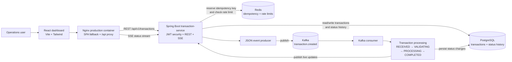
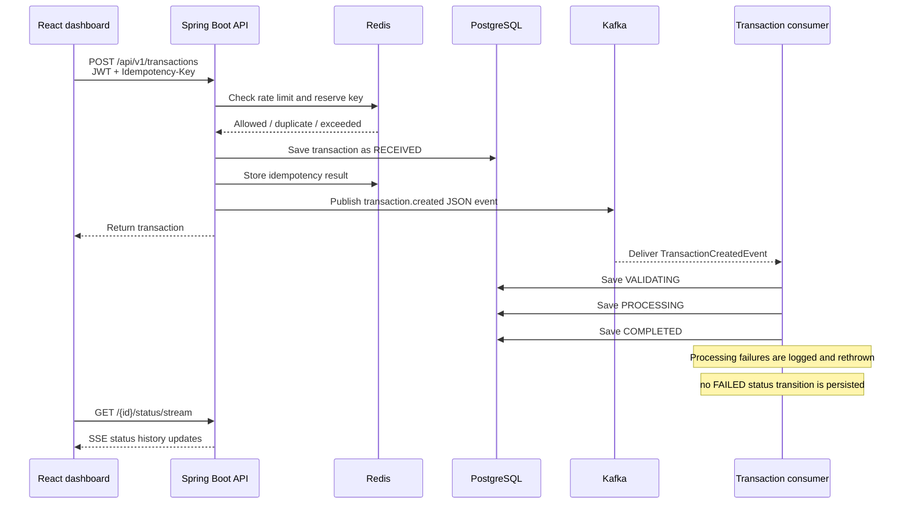

# PulseOps architecture

PulseOps is a React operations dashboard backed by a JWT-protected Spring Boot transaction API. PostgreSQL is the system of record, Kafka carries transaction-created events, and Redis handles idempotency and rate limiting.

## System architecture

## Transaction creation and processing flow

## Component responsibilities

| Component | Responsibility |
|---|---|
| React dashboard | Authenticated operations UI, transaction creation, search/filter/pagination, charts, detail history, and live status display |
| Nginx | Serves the production frontend bundle, proxies `/api`, and provides SPA route fallback |
| Spring Boot API | JWT authentication, validation, transaction endpoints, status history, SSE, structured logging, and Actuator endpoints |
| PostgreSQL | Persists transactions and status history |
| Kafka | Delivers `transaction.created` JSON events asynchronously |
| Redis | Provides idempotency protection and creation rate limiting |

## Local Docker topology

Docker Compose starts the frontend on `localhost:3001`, the API on `localhost:8080`, PostgreSQL on `localhost:5434`, Kafka on `localhost:9092`, and Redis on `localhost:6379`. Inside the Compose network, the application uses the service names `postgres`, `kafka`, and `redis`.
